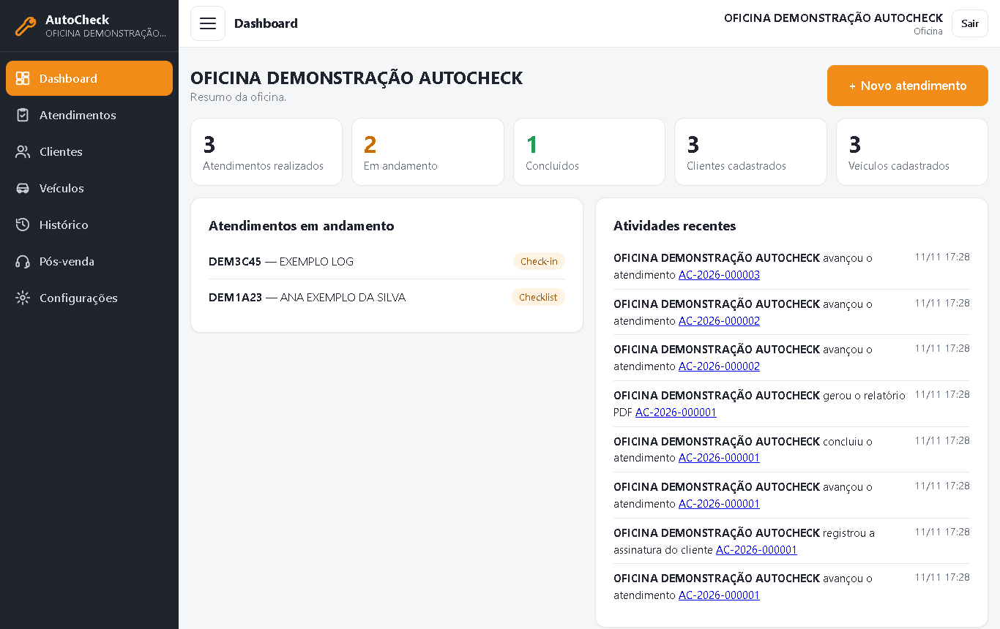
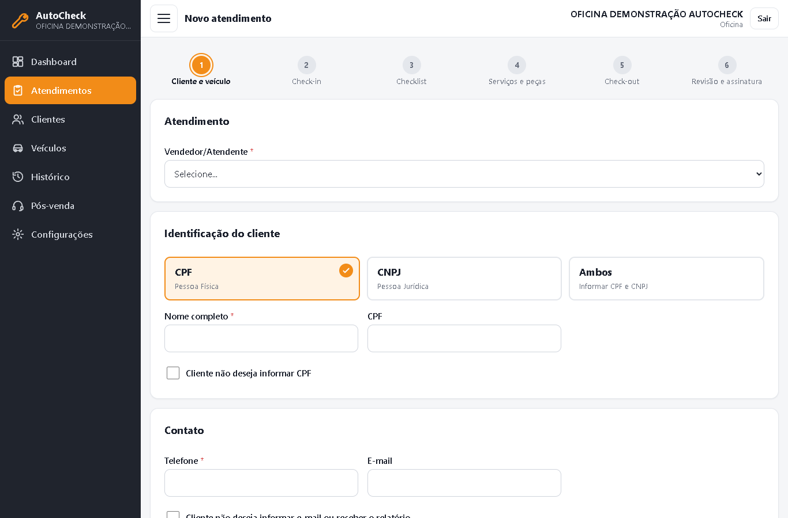
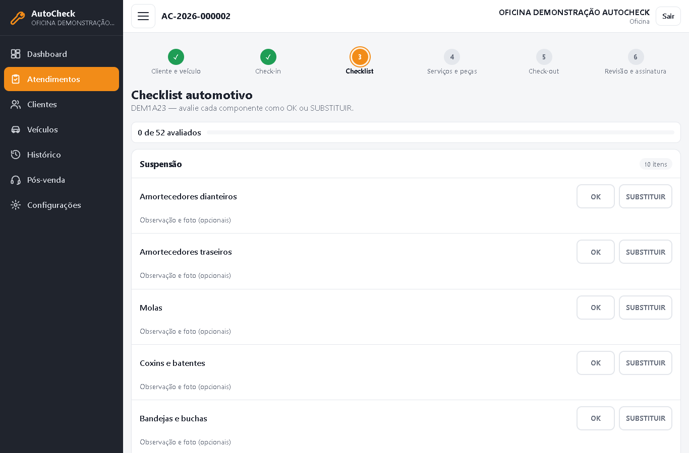
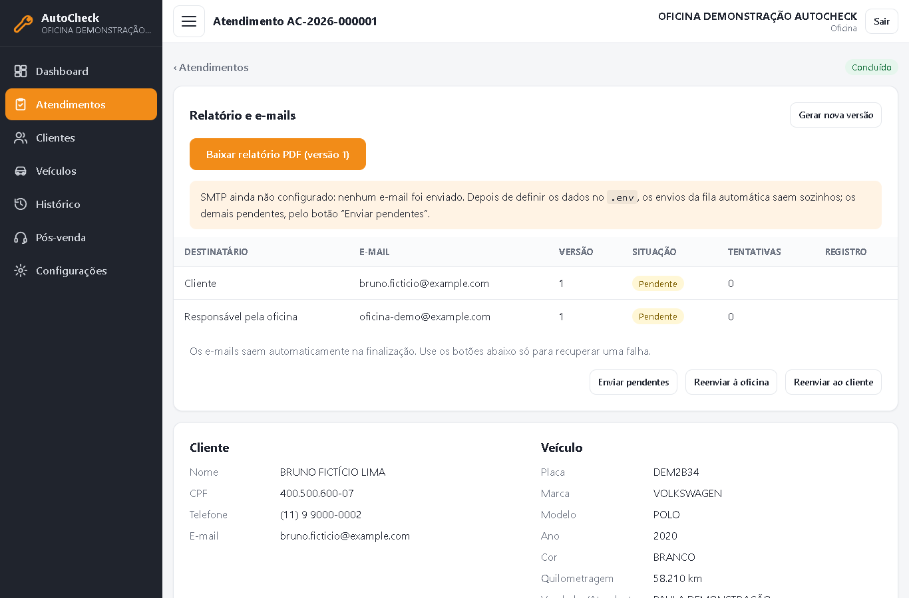
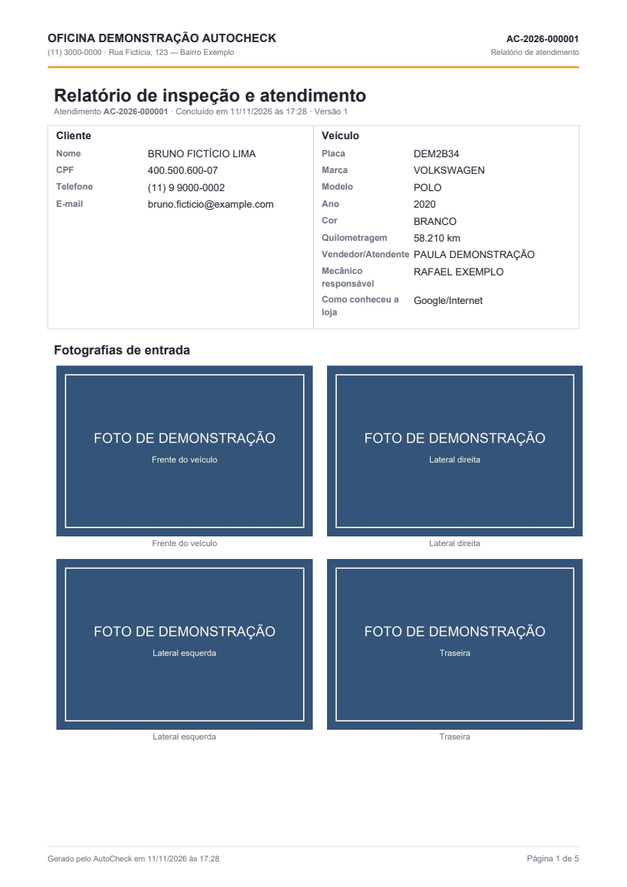

# AutoCheck

Sistema web de **inspeção automotiva e gestão de atendimentos** para oficinas mecânicas, feito com Python e Django.

O AutoCheck conduz o atendimento de ponta a ponta — cadastro do cliente e do veículo, fotos de entrada, checklist,
autorização de peças, fotos de saída e assinatura do cliente — e termina com um **relatório PDF** enviado por e-mail.
Várias oficinas usam a mesma instalação, cada uma vendo apenas os próprios dados.

> **Projeto de portfólio.** Demonstração técnica de desenvolvimento com Python/Django e do uso de ferramentas de IA
> no processo de desenvolvimento (ver [Desenvolvimento com IA](docs/DESENVOLVIMENTO_COM_IA.md)). Todos os dados de
> demonstração e de teste são fictícios.



## O problema

Em muitas oficinas, a inspeção do veículo é feita em papel ou de memória. Isso gera discussões do tipo “esse arranhão
já estava aí?”, recomendações de troca que o cliente esquece de ter recusado e nenhum histórico do veículo. O AutoCheck
registra cada etapa com fotos, exige a decisão do cliente para cada peça recomendada e entrega um documento assinado.

## Funcionalidades

- **Fluxo de atendimento em 6 etapas**, protegido no servidor: não é possível pular etapas alterando a URL ou o HTML.
  Cliente e veículo → check-in (5 fotos obrigatórias) → checklist (OK/SUBSTITUIR) e 5 pneus → serviços e peças
  (autorizar ou recusar cada recomendação) → check-out (5 fotos) → revisão e assinatura.
- **Cadastro de clientes** pessoa física, jurídica ou ambos, com validação de CPF, CNPJ (inclusive o novo formato
  alfanumérico), telefone, placa (antiga e Mercosul) e e-mail; máscaras no navegador e regras no backend.
- **Consulta de CNPJ na BrasilAPI**, sempre pelo backend; falha da API nunca impede o preenchimento manual.
- **Fotografias** com câmera do celular, EXIF removido, redimensionamento e armazenamento privado (sem URL pública).
- **Assinatura digital** desenhada na tela, vinculada ao hash SHA-256 da versão do atendimento: qualquer alteração
  posterior exige nova assinatura. Recusa em assinar também é registrada.
- **Relatório PDF** versionado (ReportLab), com fotos, checklist, recomendações recusadas e assinatura.
- **Fila de e-mails persistente** com idempotência, novas tentativas com intervalo crescente, estado “incerto” para
  quedas no meio do envio e distinção entre *tentativa*, *aceite pelo servidor SMTP* e *entrega confirmada*.
- **Várias oficinas isoladas** (multi-tenant) e uma área de administração da plataforma.
- **Histórico** por cliente e veículo, **pós-venda** (recomendações pendentes) e **retenção de dados** (LGPD) com
  simulação antes de excluir.
- **Registro de atividades** (auditoria) das operações importantes, com usuário, objeto, IP e horário.
- **PWA** instalável, com CSP restritiva (sem JavaScript inline).
- QR Code do link de avaliação da oficina no Google.

| Abertura do atendimento | Checklist |
|---|---|
|  |  |

| Relatório e fila de e-mails | Relatório PDF |
|---|---|
|  |  |

## Tecnologias

| Camada | Escolha |
|---|---|
| Linguagem / framework | Python 3.12, Django 5.2 LTS (renderização no servidor) |
| Banco de dados | SQLite (desenvolvimento) · PostgreSQL (produção, via `psycopg`) |
| Front-end | HTML, CSS e JavaScript puros, um arquivo JS por tela, sem framework |
| PDF / imagens / QR | ReportLab · Pillow · segno |
| Estáticos | WhiteNoise |
| Testes | `django.test` (unitários e integração) · Playwright (navegador real) · pypdf · aiosmtpd (SMTP local) |

## Arquitetura em resumo

Monólito modular: cada área de negócio é um app em `apps/`. Regras puras (validação de documentos, fluxo de etapas,
datas) ficam em módulos Python sem Django, testáveis isoladamente; serviços concentram as regras que mexem no banco;
views só orquestram. Detalhes, modelos e decisões em **[docs/ARQUITETURA.md](docs/ARQUITETURA.md)**.

```
autocheck/
├─ config/settings/   base · development · production · test (tudo configurado por variáveis de ambiente)
├─ apps/
│  ├─ core/           tenancy, auditoria, storage privado, validadores, seed_demo
│  ├─ accounts/       usuário (login por e-mail), bloqueio de força bruta
│  ├─ platform_admin/ cadastro de oficinas (proprietário da plataforma)
│  ├─ workshop/       configurações de cada oficina
│  ├─ customers/ vehicles/ mechanics/ employees/
│  ├─ attendances/    atendimento, fluxo de etapas e validadores
│  ├─ photos/ checklist/ tires/ replacements/ services/ signatures/
│  ├─ reports/        PDF versionado
│  ├─ mailing/        fila de e-mails
│  ├─ integrations/   BrasilAPI e contrato para sistema de gestão
│  └─ aftersales/     pós-venda e retenção de dados
├─ templates/ · static/
├─ e2e/               testes em navegador real (opcionais)
└─ docs/              arquitetura, produção, especificação original, uso de IA
```

## Como executar localmente

**Requisitos:** Python 3.12 ou 3.13 e Git. Nenhum serviço externo ou credencial é necessário para a demonstração.
O projeto foi desenvolvido e testado no Windows 10 com Python 3.12; as instruções para Linux/macOS seguem o mesmo
processo, mas não foram executadas nesses sistemas.

### Windows (PowerShell)

```powershell
git clone https://github.com/kauaxismenio/AutoCheck.git autocheck
cd autocheck
py -3.12 -m venv .venv
.\.venv\Scripts\Activate.ps1
pip install -r requirements\development.txt

Copy-Item .env.example .env
$key = python -c "import secrets; print(secrets.token_urlsafe(50))"
(Get-Content .env) -replace '^DJANGO_SECRET_KEY=.*', "DJANGO_SECRET_KEY=$key" | Set-Content .env

python manage.py migrate
python manage.py seed_demo          # pergunta a senha da conta de demonstração (não é exibida)
python manage.py runserver
```

### Linux / macOS

```bash
git clone https://github.com/kauaxismenio/AutoCheck.git autocheck
cd autocheck
python3 -m venv .venv          # confira: python3 --version deve ser 3.12 ou 3.13
source .venv/bin/activate
pip install -r requirements/development.txt

cp .env.example .env
key=$(python -c "import secrets; print(secrets.token_urlsafe(50))")
sed -i.bak "s|^DJANGO_SECRET_KEY=.*|DJANGO_SECRET_KEY=$key|" .env && rm .env.bak

python manage.py migrate
python manage.py seed_demo
python manage.py runserver
```

Acesse http://127.0.0.1:8000/ e entre com **`demo@example.com`** e a senha que você definiu.

## Conta e dados de demonstração

`python manage.py seed_demo` cria uma oficina fictícia com 3 clientes, 3 veículos e 3 atendimentos: um concluído (com
PDF gerado) e dois em andamento, prontos para você continuar o fluxo.

- **Senha:** o comando pergunta (sem eco). Alternativas: definir `AUTOCHECK_DEMO_PASSWORD` no `.env` antes de rodar,
  ou criar sem senha (`--no-input`) e depois usar `python manage.py changepassword demo@example.com`.
  A senha nunca é exibida nem gravada em arquivo pelo comando.
- **Só acrescenta dados:** não altera nem apaga nada existente; rodar de novo não duplica.
- **Nenhum e-mail é enviado:** todos os endereços usam o domínio reservado `example.com`, e os envios da demonstração
  ficam fora da fila automática — só saem se você clicar em “Enviar pendentes” com SMTP configurado.
- **Administração da plataforma** (cadastrar outras oficinas): `python manage.py createsuperuser` e acesse
  `/plataforma/`.

As fotos são imagens geradas com o texto “FOTO DE DEMONSTRAÇÃO”. Para testar o upload real, use qualquer JPEG/PNG.

## Variáveis de ambiente

Tudo fica no `.env` (nunca versionado); o modelo comentado é o [`.env.example`](.env.example). Principais:

| Variável | Para quê | Padrão |
|---|---|---|
| `DJANGO_SECRET_KEY` | chave do Django (**obrigatória**) | — |
| `DJANGO_DEBUG` | modo de desenvolvimento | `true` em `development` |
| `DB_ENGINE` | `sqlite` ou `postgresql` | `sqlite` |
| `EMAIL_HOST` e demais `EMAIL_*` | SMTP. Vazio = e-mails no console, nunca contados como enviados | vazio |
| `BRASILAPI_BASE_URL` | consulta de CNPJ (gratuita, sem credencial) | API pública |
| `MANAGEMENT_API_*` | integração com sistema de gestão (não implementada; deixe vazio) | vazio |
| `AUTOCHECK_DEMO_PASSWORD` | senha da conta de demonstração (opcional) | — |

### Testar o envio real de e-mail (opcional)

Preencha `EMAIL_HOST`, `EMAIL_PORT`, `EMAIL_HOST_USER`, `EMAIL_HOST_PASSWORD` e `DEFAULT_FROM_EMAIL` com uma conta
sua (por exemplo, uma senha de app do seu provedor), reinicie o servidor e use **Configurações → Enviar e-mail de
teste**. Mude o e-mail do responsável e o do cliente para endereços seus antes de concluir um atendimento.

A fila tem um processamento separado do site, que pode ser rodado sob demanda:

```bash
python manage.py process_email_queue --status   # situação da fila, sem enviar nada
python manage.py process_email_queue            # uma passada
python manage.py process_email_queue --loop     # contínuo; Ctrl+C termina o envio em curso e encerra
```

“Aceito pelo servidor SMTP” significa só que o servidor recebeu a mensagem — **não** garante que ela chegou à caixa de
entrada. “Entrega confirmada” exige um evento do provedor, e nenhuma integração com provedor foi implementada.

## Testes

```bash
python manage.py check
python manage.py test --settings=config.settings.test
```

Usam banco em memória e uma pasta temporária `.test_tmp/` (apagada ao final); não tocam no `db.sqlite3` nem em
`private_media/`, e não enviam e-mails (backend `locmem`). Cobrem regras puras, permissões, isolamento entre
oficinas (varredura de todas as rotas), fluxo completo pelas views, PDF (texto lido com pypdf), fila de e-mails
(inclusive contra um servidor SMTP local: aceite, recusa 550 e servidor fora do ar) e o `seed_demo`.

Opcionais, que dependem de recursos externos:

```bash
# Navegador real (Playwright + Microsoft Edge; use E2E_CHANNEL=chrome para o Chrome).
# Requer o navegador instalado; parte dos testes consulta a BrasilAPI de verdade.
RUN_E2E=1 python manage.py test e2e --settings=config.settings.test

# Consulta real à BrasilAPI pelo cliente Python
RUN_REAL_API=1 python manage.py test apps.integrations --settings=config.settings.test
```

No PowerShell, defina a variável antes: `$env:RUN_E2E="1"`.

## Outros comandos

| Comando | Função |
|---|---|
| `seed_checklist` | carrega o catálogo do checklist (o `seed_demo` já chama) |
| `seed_demo` | cria a oficina de demonstração |
| `process_email_queue` | processa a fila de e-mails |
| `purge_expired` | retenção: simula por padrão; `--execute` exclui de fato |

## Documentação

- [docs/ARQUITETURA.md](docs/ARQUITETURA.md) — módulos, modelos, fluxo, integrações, fila de e-mails, segurança,
  limitações.
- [docs/DESENVOLVIMENTO_COM_IA.md](docs/DESENVOLVIMENTO_COM_IA.md) — como a IA foi usada no projeto.
- [docs/PRODUCAO.md](docs/PRODUCAO.md) — guia de implantação (PostgreSQL, HTTPS, serviço da fila).
- [docs/ESPECIFICACAO.md](docs/ESPECIFICACAO.md) — especificação original de requisitos.
- [PROJECT_CONTEXT.md](PROJECT_CONTEXT.md) — diário técnico das etapas e decisões.

## Limitações conhecidas

- Integração com sistema de gestão: só o contrato e o tratamento de erros; nenhuma API real foi conectada.
- Confirmação de entrega de e-mail: o modelo suporta, mas nenhum provedor envia esses eventos ao sistema.
- PostgreSQL, HTTPS, câmera e assinatura com dedo em aparelho Android real não foram testados.
- O catálogo do checklist é genérico (47 componentes) e pode ser ajustado em `apps/checklist/catalog.py`.
- Interface apenas em português do Brasil.
